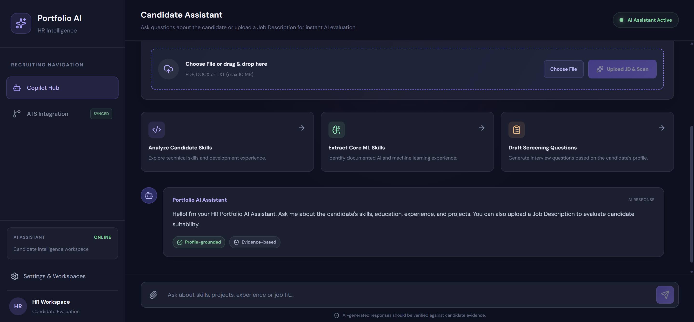
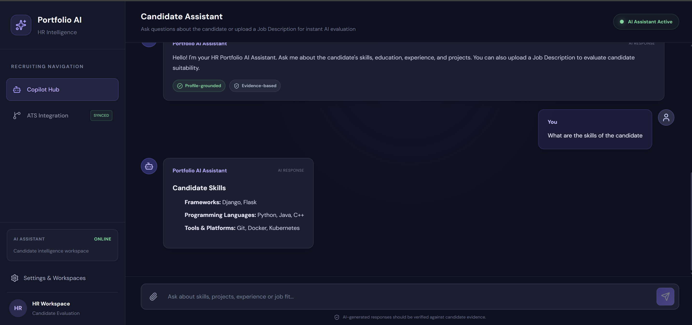
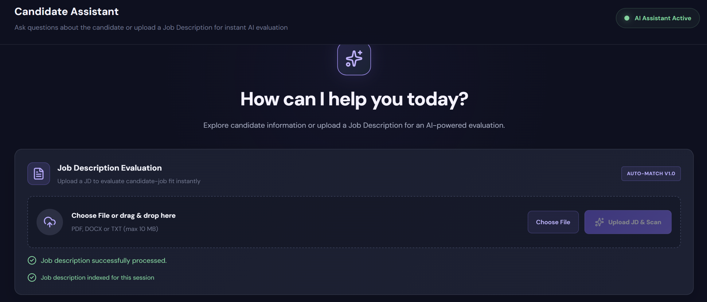
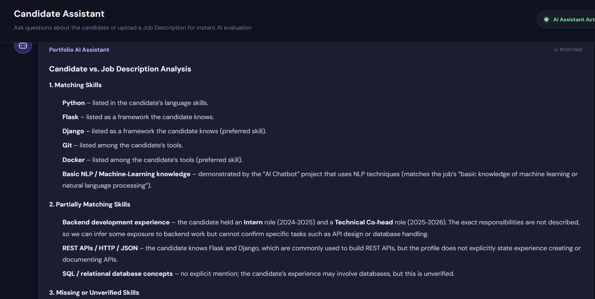
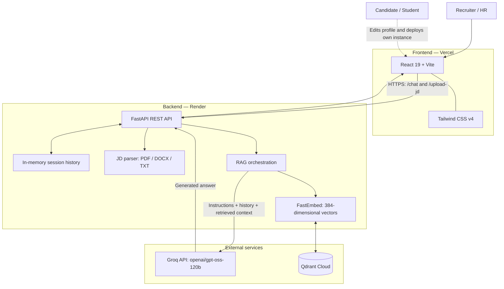
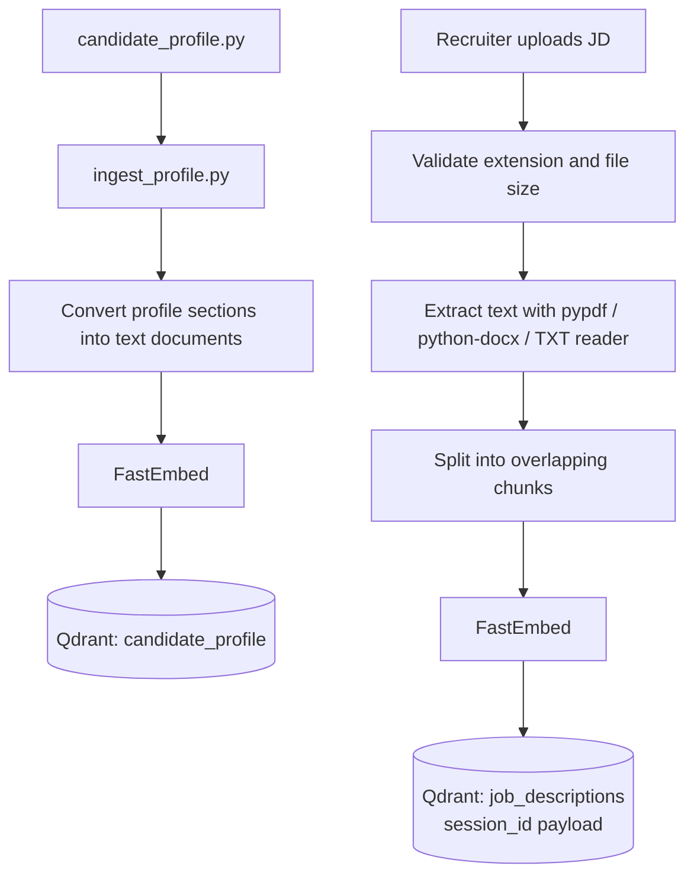
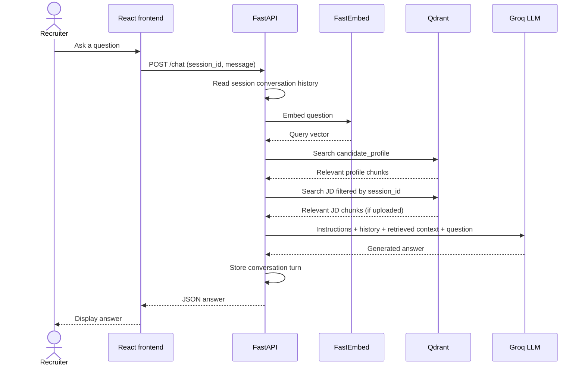
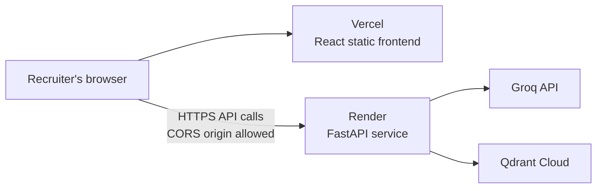

<div align="center">

# HR Portfolio AI

### A Retrieval-Augmented Generation assistant for candidate portfolios and job-description analysis

**Explore a candidate's skills, education, experience and projects through natural language — then compare the profile with a job description.**

[](https://hr-portfolio-ai.vercel.app/)
[](https://portfolio-ai-bz6f.onrender.com/docs)
[](https://hr-portfolio-ai.vercel.app/)

</div>

---

## Table of contents

1. [Project overview](#1-project-overview)
2. [Live application](#2-live-application)
3. [Who is this for?](#3-who-is-this-for)
4. [Features](#4-features)
5. [System architecture](#5-system-architecture)
6. [End-to-end lifecycle](#6-end-to-end-lifecycle)
7. [Technology stack](#7-technology-stack)
8. [Repository structure](#8-repository-structure)
9. [Recruiter guide](#9-recruiter-guide)
10. [Run locally](#10-run-locally)
11. [Configure another candidate](#11-configure-another-candidate)
12. [Environment variables](#12-environment-variables)
13. [API reference](#13-api-reference)
14. [Data and retrieval design](#14-data-and-retrieval-design)
15. [Deployment](#15-deployment)
16. [Testing checklist](#16-testing-checklist)
17. [Security and privacy](#17-security-and-privacy)
18. [Limitations and roadmap](#18-limitations-and-roadmap)
19. [Troubleshooting](#19-troubleshooting)
20. [Contributing](#20-contributing)
21. [Acknowledgements](#21-acknowledgements)

---

## 1. Project overview

**HR Portfolio AI** is an AI-powered candidate portfolio assistant. It gives recruiters a conversational way to explore a candidate's professional information and optionally compare that information with a job description.

Rather than manually searching through a resume, project descriptions and experience records, a recruiter can ask questions in natural language. The application retrieves relevant information from the candidate profile and, when provided, the uploaded job description. It then supplies this context to a language model to generate an answer.

The system is built around **Retrieval-Augmented Generation (RAG)**: candidate data and job-description text are converted into vector embeddings and stored in Qdrant. At question time, semantically relevant chunks are retrieved and included in the LLM request.

### The problem

Candidate information is often spread across resumes, project descriptions, education details and experience records. Recruiters need to repeatedly locate this information and compare it with the requirements of a role.

### The solution

HR Portfolio AI provides:

- A structured, editable candidate profile.
- Natural-language Q&A over that profile.
- Job-description upload and text extraction.
- Semantic retrieval of relevant profile and JD information.
- Session-filtered JD retrieval.
- A browser-based interface that requires no local setup from recruiters.

### Grounding principle

The assistant is intended to answer from the candidate profile and uploaded JD context. If a fact is not present in the retrieved information, it should communicate that the information is unavailable rather than inventing a candidate claim.

> **Important:** AI-generated responses are decision-support material, not hiring decisions. Recruiters should verify important claims against original candidate evidence.

---

## 2. Live application

| Component | URL |
|---|---|
| **Frontend application** | https://hr-portfolio-ai.vercel.app/ |
| **Backend API** | https://portfolio-ai-bz6f.onrender.com |
| **Interactive API documentation** | https://portfolio-ai-bz6f.onrender.com/docs |
| **GitHub repository** | https://github.com/Shubham-Vaidya/Portfolio_AI |

### Application screenshots

#### Main Application


#### Candidate Q&A


#### Job Description Upload


#### Job Description Analysis


The frontend is hosted on Vercel, the FastAPI backend is hosted on Render, and Qdrant Cloud stores vector data. Groq provides language-model inference.

**Free-hosting note:** The Render free web service may spin down after inactivity. The first request after a quiet period can take longer while the service starts.

---

## 3. Who is this for?

### Recruiters and hiring teams

Recruiters can use the live application immediately. No cloning, installation or API credentials are required.

1. Open the [HR Portfolio AI application](https://hr-portfolio-ai.vercel.app/).
2. Ask a question about the candidate.
3. Optionally upload a job description.
4. Ask follow-up questions about relevant skills, evidence and missing information.

### Students and candidates

A candidate can fork or clone the repository, replace the example profile with their own information, configure their own Groq and Qdrant credentials, index their profile and deploy a personalized instance.

The candidate profile is maintained in one Python file. The ingestion script converts it into searchable vector records, so the same application and RAG pipeline can be reused for another candidate.

---

## 4. Features

### Candidate portfolio Q&A

Example questions:

- What programming languages does the candidate know?
- What projects has the candidate built?
- What frameworks and tools are listed?
- What is the candidate's educational background?
- What leadership or internship experience is documented?

### Job-description analysis

- Upload PDF, DOCX or TXT documents.
- Extract document text.
- Split extracted text into overlapping chunks.
- Generate embeddings for the chunks.
- Store JD vectors in Qdrant with a session identifier.
- Retrieve JD context for questions from the same session.

### Candidate–JD comparison

Example questions:

- Which candidate skills match this job description?
- Which required skills are not present in the profile?
- Which projects provide evidence relevant to this role?
- What should a recruiter clarify during an interview?

The assistant should distinguish between a skill explicitly listed in the profile, a requirement stated in the JD and an inference that needs human verification.

### Conversational interface

- React chat interface.
- Browser session identifier stored in `sessionStorage`.
- Backend conversation history maintained while the process is running.
- Markdown-capable response presentation.
- Upload progress, loading state and error feedback.
- Automatic scroll to the latest message.

### Lightweight embedding runtime

The deployed backend uses **FastEmbed** instead of the heavier Sentence Transformers/PyTorch runtime. This migration was made to reduce memory pressure on the free Render instance. The embedding model produces 384-dimensional vectors for Qdrant.

---

## 5. System architecture

### 5.1 High-level architecture



### 5.2 Data ingestion architecture



### 5.3 Question-answering sequence



### 5.4 Deployment architecture



---

## 6. End-to-end lifecycle

### A. Candidate profile ingestion

1. Candidate information is maintained in `candidate_profile.py`.
2. `ingest_profile.py` imports the profile.
3. The RAG layer converts profile sections into text documents.
4. FastEmbed generates an embedding for each document.
5. The `candidate_profile` collection is created/reset and populated with vectors and text payloads.

### B. Job-description upload

1. The frontend creates a `FormData` payload containing the session ID and selected file.
2. The backend validates the extension and enforces a 10 MB upload limit.
3. `jd_parser.py` extracts text from PDF, DOCX or TXT.
4. The text is split into chunks (approximately 1,000 characters with 150 characters of overlap).
5. FastEmbed creates vectors for the chunks.
6. The vectors and text are stored in `job_descriptions` with the corresponding `session_id`.
7. If the same session uploads another JD, its previous JD points are deleted before the new chunks are indexed.

### C. Chat request

1. The frontend sends the session ID and message to `/chat`.
2. The backend loads the conversation history for that session.
3. The question is embedded and used to retrieve relevant candidate-profile chunks.
4. If a JD exists for the session, relevant JD chunks are retrieved with a `session_id` filter.
5. The backend builds the LLM request using instructions, conversation history and retrieved context.
6. Groq generates the answer.
7. The backend stores the conversation turn and returns the answer to the frontend.

---

## 7. Technology stack

| Layer | Technology | Responsibility |
|---|---|---|
| Frontend framework | React 19 | Component-based user interface |
| Frontend build tool | Vite | Development server and production build |
| Styling | Tailwind CSS v4 | Utility-first styling |
| Icons | Lucide React | Interface icons |
| Markdown rendering | React Markdown, remark-gfm | Formatted assistant responses |
| API framework | FastAPI | Backend REST endpoints |
| ASGI server | Uvicorn | Runs the FastAPI application |
| LLM provider | Groq | Language-model inference |
| Chat model | `openai/gpt-oss-120b` | Natural-language response generation |
| Embedding runtime | FastEmbed | Local embedding generation |
| Embedding model | `sentence-transformers/all-MiniLM-L6-v2` | Semantic vector representations |
| Vector database | Qdrant Cloud | Stores and retrieves profile/JD vectors |
| PDF extraction | pypdf | Reads text from PDFs |
| Word extraction | python-docx | Reads DOCX documents |
| Upload handling | python-multipart | Multipart file uploads |
| Configuration | python-dotenv | Loads local environment variables |
| Python dependency management | uv | Dependency installation and lockfile |
| Frontend hosting | Vercel | Hosts the React application |
| Backend hosting | Render | Hosts the FastAPI service |
| Version control | Git + GitHub | Source control and deployment integration |

### Why RAG?

A language model alone does not automatically know the private or current details in a candidate's profile. RAG supplies relevant source information at question time.

**Retrieve → Augment → Generate**

- **Retrieve:** Search Qdrant for relevant candidate and JD chunks.
- **Augment:** Add retrieved information to the model request.
- **Generate:** Ask the LLM to produce a response grounded in that context.

### Why FastEmbed?

The initial Sentence Transformers implementation relied on a heavier runtime that exceeded the memory available to the free Render service. FastEmbed was adopted as a lighter embedding runtime. The vector size remains 384 dimensions.

---

## 8. Repository structure

The GitHub repository is a monorepo. The application lives under `Portfolio_AI/hr-portfolio-ai/`.

```text
Portfolio_AI/
└── hr-portfolio-ai/
    ├── api.py                    # FastAPI application and HTTP endpoints
    ├── main.py                   # LLM interaction and answer orchestration
    ├── rag.py                    # Embeddings, Qdrant, indexing and retrieval
    ├── candidate_profile.py      # Candidate's editable profile data
    ├── ingest_profile.py         # Profile-to-Qdrant ingestion script
    ├── jd_parser.py              # PDF, DOCX and TXT extraction + chunking
    ├── pyproject.toml             # Python project and dependencies
    ├── uv.lock                    # Locked Python dependency versions
    ├── .python-version            # Python version selection
    ├── .env                       # Local secrets (never commit)
    ├── .gitignore
    ├── README.md
    └── frontend/
        ├── src/
        │   ├── App.jsx            # Main chat and upload interface
        │   ├── App.css            # Application styles
        │   └── ...
        ├── public/
        ├── index.html
        ├── package.json
        ├── package-lock.json
        └── vite.config.js
```

This tree highlights the main application files; minor configuration and test files may vary by checkout. Do not commit `.env`, virtual environments, `node_modules` or local Qdrant storage.

---

## 9. Recruiter guide

Recruiters do not need to clone the repository or configure credentials.

### Step 1 — Open the application

Go to **https://hr-portfolio-ai.vercel.app/**.

### Step 2 — Ask about the candidate

```text
What programming languages does the candidate know?

Summarize the candidate's education and experience.

What projects has the candidate worked on?

Which tools and frameworks are mentioned in the profile?
```

### Step 3 — Upload a job description (optional)

1. Select **Choose File**.
2. Select a PDF, DOCX or TXT job description.
3. Upload the file.
4. Wait for the success confirmation.

The current upload limit is 10 MB.

### Step 4 — Ask role-specific questions

```text
What are the key requirements in this job description?

Which candidate skills match the requirements?

Which required skills are not mentioned in the candidate profile?

Which projects provide relevant evidence for this role?

What should I ask the candidate to verify the gaps?
```

### Tips for better answers

- Ask specific questions rather than combining unrelated topics.
- Upload the JD before asking JD-specific questions.
- Keep follow-up questions in the same browser session.
- Verify important claims against the original resume, project links or other evidence.

---

## 10. Run locally

This section is for candidates, students and developers who want to create their own instance.

### 10.1 Prerequisites

| Requirement | Purpose |
|---|---|
| Git | Clone the repository |
| Python 3.13 | Backend runtime |
| uv | Python environment and dependency management |
| Node.js + npm | Frontend development |
| Groq API key | LLM responses |
| Qdrant Cloud account/cluster | Hosted vector database |

A local Qdrant persistent-storage fallback is available when Qdrant Cloud environment variables are not configured.

### 10.2 Clone the repository

```bash
git clone https://github.com/Shubham-Vaidya/Portfolio_AI.git
cd Portfolio_AI/Portfolio_AI/hr-portfolio-ai
```

If you fork the repository, clone your fork's URL instead.

### 10.3 Create the backend environment file

Create `.env` in the `hr-portfolio-ai` backend directory:

```env
GROQ_API_KEY=your_groq_api_key

# Qdrant Cloud configuration
QDRANT_URL=https://your-cluster-url
QDRANT_API_KEY=your_qdrant_api_key

# Optional: deployed frontend origin for CORS
FRONTEND_URL=
```

For local development, the backend permits the Vite origins:

- `http://localhost:5173`
- `http://127.0.0.1:5173`

If `QDRANT_URL` is omitted, the RAG layer uses local persistent storage under `qdrant_storage/`.

**Never commit `.env` or expose API keys in source code, screenshots, logs or public repositories.**

### 10.4 Install backend dependencies

From the backend directory:

```bash
uv sync
```

This installs dependencies declared in `pyproject.toml` and `uv.lock`.

If `uv` is not installed, follow the official installation instructions: https://docs.astral.sh/uv/

### 10.5 Configure your candidate profile

Open `candidate_profile.py` and replace the sample profile with your own details. See [Configure another candidate](#11-configure-another-candidate).

### 10.6 Index the candidate profile

Run from the backend directory:

```bash
uv run python ingest_profile.py
```

This creates or resets the `candidate_profile` collection and indexes the current profile.

Run this command again whenever the candidate profile changes.

### 10.7 Start the backend

```bash
uv run uvicorn api:app --reload
```

The local backend is available at:

```text
http://127.0.0.1:8000
```

Interactive API documentation:

```text
http://127.0.0.1:8000/docs
```

### 10.8 Install frontend dependencies

Open a second terminal:

```bash
cd Portfolio_AI/hr-portfolio-ai/frontend
npm install
```

Create `frontend/.env` if you want to explicitly configure the local API URL:

```env
VITE_API_URL=http://127.0.0.1:8000
```

### 10.9 Start the frontend

```bash
npm run dev
```

Vite normally serves the application at:

```text
http://localhost:5173
```

Open that URL in your browser. Keep both backend and frontend terminals running during local development.

### 10.10 Build the frontend

```bash
npm run build
```

The production build is generated in `frontend/dist/`.

---

## 11. Configure another candidate

This is the main customization step for a student or candidate creating a personalized instance.

### 11.1 Edit `candidate_profile.py`

The profile is represented as a Python dictionary. The RAG pipeline converts its sections into text documents before embedding them.

Example schema:

```python
profile = {
    "personal_info": {
        "name": "Your Name",
        "location": "Your City, Country",
        "email": "you@example.com"
    },

    "education": [
        {
            "degree": "B.Tech in Computer Engineering",
            "institution": "Your College",
            "year": "2024-2028"
        }
    ],

    "skills": [
        {"Languages": ["Python", "Java", "C++"]},
        {"Frameworks": ["React", "FastAPI"]},
        {"Tools": ["Git", "Docker"]}
    ],

    "experience": [
        {
            "position": "Your Role",
            "organization": "Organization Name",
            "duration": "2025-2026"
        }
    ],

    "projects": [
        {
            "title": "Project Name",
            "description": "What you built, how you built it, and its outcome."
        }
    ]
}
```

This is a schema example, not real candidate information. Replace every example value with accurate information. Additional sections such as certifications, achievements, coursework, publications, leadership, volunteering and links can be added using ordinary Python dictionaries, lists and strings.

### 11.2 Re-index after editing

From the backend directory:

```bash
uv run python ingest_profile.py
```

The ingestion process resets the `candidate_profile` collection before inserting the new profile vectors.

> **Important:** This replaces the candidate-profile collection in the configured Qdrant database. Do not point multiple independent candidate deployments at the same collection unless you redesign the data model for multi-candidate isolation.

### 11.3 Verify the new profile

Start the backend and ask:

```text
Who is the candidate?

What skills are listed in the profile?

What projects has the candidate completed?

What experience is documented?
```

Compare the answers with the profile you entered.

### 11.4 Deploy your personalized instance

1. Fork the GitHub repository or create your own repository.
2. Update `candidate_profile.py`.
3. Create your own Groq API key and Qdrant Cloud cluster.
4. Configure backend environment variables on Render.
5. Run profile ingestion against your own Qdrant database.
6. Deploy the backend.
7. Deploy the `frontend/` directory on Vercel.
8. Set Vercel's `VITE_API_URL` to your backend URL.
9. Set Render's `FRONTEND_URL` to your deployed frontend origin.

Do not use another candidate's API keys or database credentials.

---

## 12. Environment variables

### Backend — Render and local `.env`

| Variable | Required? | Description |
|---|---:|---|
| `GROQ_API_KEY` | Yes | Authenticates requests to Groq |
| `QDRANT_URL` | For Qdrant Cloud | Cluster URL. If omitted, local persistent storage is used |
| `QDRANT_API_KEY` | For Qdrant Cloud | API key for the configured cluster |
| `FRONTEND_URL` | Production | Frontend origin allowed by backend CORS |

When using Qdrant Cloud, configure both `QDRANT_URL` and `QDRANT_API_KEY`.

### Frontend — `frontend/.env`

| Variable | Required? | Description |
|---|---:|---|
| `VITE_API_URL` | Recommended | Backend base URL used by browser-side code |

Local example:

```env
VITE_API_URL=http://127.0.0.1:8000
```

Production example:

```env
VITE_API_URL=https://your-backend.onrender.com
```

Vite exposes variables prefixed with `VITE_` to browser-side code. **Never put private API keys in frontend environment variables.**

---

## 13. API reference

Interactive documentation:

**https://portfolio-ai-bz6f.onrender.com/docs**

The primary application endpoints are:

### `POST /chat`

Sends a user message and returns an assistant answer.

Request body:

```json
{
  "session_id": "a-unique-session-id",
  "message": "What programming languages does the candidate know?"
}
```

The session ID associates the conversation and uploaded JD context with a browser session.

### `POST /upload-jd`

Uploads and indexes a job description.

Content type: `multipart/form-data`

| Field | Type | Description |
|---|---|---|
| `session_id` | String | Session that owns the uploaded JD |
| `file` | File | PDF, DOCX or TXT document |

The frontend currently enforces a 10 MB limit and accepts `.pdf`, `.docx` and `.txt`.

### API behavior

- Chat requests use a session ID and message.
- JD retrieval is filtered by the session ID.
- A new JD uploaded to the same session replaces that session's previously indexed JD chunks.
- Check the live Swagger documentation and current `api.py` for exact response schemas and validation details.

---

## 14. Data and retrieval design

### 14.1 Qdrant collections

| Collection | Contents | Important payload fields |
|---|---|---|
| `candidate_profile` | Candidate profile text chunks and vectors | `text`, `category`, `source` |
| `job_descriptions` | Uploaded JD chunks and vectors | `text`, `source`, `session_id`, `chunk_index` |

Both collections use 384-dimensional vectors and cosine similarity.

### 14.2 Candidate profile retrieval

- The profile is transformed into text documents by section.
- Each document is embedded.
- Text and category are stored as Qdrant payload.
- A question is embedded using the same model.
- The nearest profile chunks are retrieved (current default `top_k=4`).

### 14.3 Job-description retrieval

- JD text is extracted and chunked.
- Each chunk is embedded and stored with a session ID.
- The `session_id` payload field is indexed for filtering.
- JD retrieval filters by the active session ID (current default `top_k=5`).

This filter prevents a retrieval query from intentionally searching another session's JD chunks.

### 14.4 Conversation memory

The frontend stores a session ID in browser `sessionStorage`. The backend keeps conversation history in process memory.

This is lightweight but not durable storage:

- Backend restarts clear in-memory conversation history.
- A different browser session gets a different session ID.
- Multiple backend instances do not automatically share in-memory histories.

---

## 15. Deployment

### 15.1 Backend — Render

The backend is deployed from the monorepo using the backend subdirectory as its root.

| Setting | Value |
|---|---|
| Service type | Web Service |
| Runtime | Python |
| Root Directory | `Portfolio_AI/hr-portfolio-ai` |
| Python version | `3.13.14` |
| Build command | `pip install uv && uv sync --frozen --no-dev` |
| Start command | `uv run uvicorn api:app --host 0.0.0.0 --port $PORT` |

Configure the backend environment variables listed in [Environment variables](#12-environment-variables).

### 15.2 Frontend — Vercel

The frontend is deployed from the same GitHub repository.

| Setting | Value |
|---|---|
| Framework preset | Vite |
| Root Directory | `Portfolio_AI/hr-portfolio-ai/frontend` |
| Build command | `npm run build` |
| Output directory | `dist` |
| Install command | `npm install` |
| Environment variable | `VITE_API_URL=https://your-backend.onrender.com` |

### 15.3 CORS

The backend allows local Vite origins and the production frontend origin supplied through `FRONTEND_URL`.

For a new deployment, set `FRONTEND_URL` to the exact frontend origin, without a trailing slash:

```text
https://your-project.vercel.app
```

Restart/redeploy the backend after changing environment variables so the new configuration is loaded.

### 15.4 Deployment flow

The GitHub repository is connected to both hosting providers. Pushing tracked application changes can trigger automatic deployments, depending on each service's deployment settings.

---

## 16. Testing checklist

### Backend

- [ ] Backend starts without import or configuration errors.
- [ ] Swagger documentation loads at `/docs`.
- [ ] Qdrant connection succeeds.
- [ ] Candidate profile collection exists.
- [ ] Profile ingestion completes successfully.
- [ ] Profile retrieval returns relevant content.
- [ ] `/chat` returns an answer for a valid session.
- [ ] `/upload-jd` accepts a valid PDF, DOCX or TXT file.
- [ ] Unsupported extensions are rejected.
- [ ] Files larger than the configured limit are rejected.
- [ ] JD retrieval for one session does not return another session's JD chunks.

### Frontend

- [ ] Vite development server starts.
- [ ] Chat page renders.
- [ ] A message can be submitted.
- [ ] Loading and error states are visible.
- [ ] A JD can be selected and uploaded.
- [ ] Upload success is displayed.
- [ ] Follow-up messages use the same session.
- [ ] Production frontend calls the deployed backend.

### Suggested evaluation questions

```text
What programming languages does the candidate know?

Summarize the candidate's project experience.

What are the main requirements in the uploaded job description?

Which requirements are supported by the candidate profile?

Which requirements are not mentioned in the profile?

What information is unavailable and should be verified?
```

---

## 17. Security and privacy

This project handles personal candidate information and recruiter-uploaded job descriptions. Treat both as confidential.

- Use your own Groq and Qdrant credentials.
- Keep `.env` out of Git.
- Never expose Groq or Qdrant credentials in frontend code.
- Do not put sensitive candidate information in a public repository.
- Use a private repository if the profile contains personal or confidential details.
- Share the live application only when the candidate has agreed to the information being displayed.
- Review the data-handling policies of the model provider, hosting provider and database provider before using real recruitment data.
- The current session ID is a routing/isolation key, not a complete authentication or authorization mechanism.
- The current app does not provide recruiter authentication or role-based access control.
- Do not treat a session ID alone as a security boundary for sensitive production data.
- Uploaded JD chunks remain in Qdrant until replaced for that session or explicitly deleted. A production deployment should implement retention and deletion policies.

---

## 18. Limitations and roadmap

The current implementation is a functional Version 1 designed to keep infrastructure lightweight.

| Area | Current behavior | Possible improvement |
|---|---|---|
| Authentication | No recruiter login | Add authentication and authorization |
| Candidate support | One active profile per deployment | Add candidate IDs and tenant-aware collections/filters |
| Conversation memory | In-process memory | Persist history in PostgreSQL or another durable store |
| Session security | Browser-generated session ID | Use authenticated, server-managed sessions |
| JD retention | Stored in Qdrant by session | Add expiry, deletion and retention controls |
| PDF extraction | Text-based extraction | Add OCR for scanned PDFs |
| Evaluation | LLM-generated responses | Add evaluation dataset and regression tests |
| Observability | Basic logs | Add structured logs, tracing and error monitoring |
| Deployment | Free Render instance may sleep | Use always-on hosting when operational needs justify it |
| Profile format | Python dictionary | Add validated JSON/YAML or an admin profile editor |

Before using this as a real recruitment product, implement authentication, stronger tenant isolation, persistent sessions, data-retention controls, monitoring and systematic answer-quality evaluation.

---

## 19. Troubleshooting

### Missing environment variables

Check that the backend `.env` file exists locally and contains the required Groq and Qdrant settings. On Render, check the service's Environment page. Never paste secret values into public issue reports.

### Candidate profile collection is missing

Run from the backend directory:

```bash
uv run python ingest_profile.py
```

Confirm the command points to the intended Qdrant database.

### Qdrant connection fails

Verify that:

- `QDRANT_URL` is the cluster URL, not the dashboard URL.
- `QDRANT_API_KEY` belongs to that cluster.
- Both values are configured in the environment where the backend runs.

### Frontend cannot reach the backend

Verify that:

- `VITE_API_URL` points to the correct backend base URL.
- `FRONTEND_URL` on Render matches the frontend origin.
- The backend restarted after the CORS change.
- Browser developer tools and Render logs do not show network or CORS errors.

### Vercel build cannot find a package

Run `npm install` in the frontend directory, verify that the dependency is listed in `frontend/package.json`, then commit both `package.json` and `package-lock.json`.

### First request is slow

The free Render instance can spin down after inactivity. Allow time for the first request to wake the service.

### JD upload succeeds but answers do not use the JD

Check that the chat request uses the same `session_id` as the upload request. The backend retrieves JD chunks using that session identifier.

---

## 20. Contributing

Contributions, issue reports and suggestions are welcome.

1. Fork the repository.
2. Create a feature branch.
3. Make a focused change.
4. Run the relevant backend or frontend checks.
5. Commit with a clear message.
6. Open a pull request describing the change and how it was tested.

For changes to retrieval, prompt construction or session isolation, include tests demonstrating the expected behavior.

---

## 21. Acknowledgements

Built using the Python and JavaScript ecosystems and the hosted services listed above.

- [FastAPI](https://fastapi.tiangolo.com/)
- [React](https://react.dev/)
- [Vite](https://vite.dev/)
- [Tailwind CSS](https://tailwindcss.com/)
- [Groq](https://groq.com/)
- [Qdrant](https://qdrant.tech/)
- [FastEmbed](https://qdrant.github.io/fastembed/)
- [Render](https://render.com/)
- [Vercel](https://vercel.com/)

---

<div align="center">

**HR Portfolio AI — making candidate portfolios easier to explore, understand and compare.**

[Live Application](https://hr-portfolio-ai.vercel.app/) · [API Documentation](https://portfolio-ai-bz6f.onrender.com/docs) · [GitHub](https://github.com/Shubham-Vaidya/Portfolio_AI)

</div>
